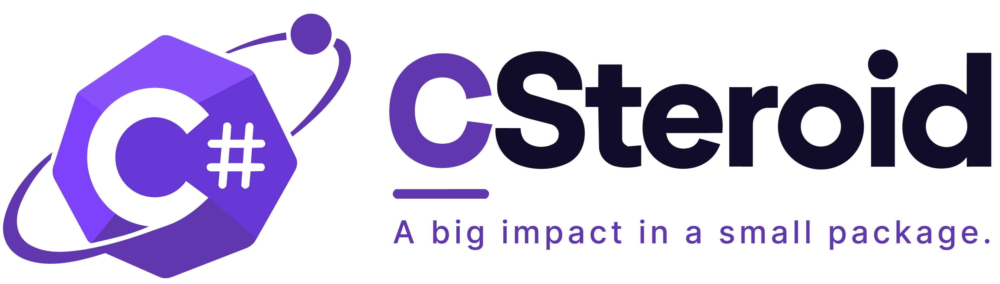

[](https://github.com/Tyme-Bleyaert/CSteroid/actions/workflows/ci.yml)
[](https://www.nuget.org/packages/CSteroid.Core)
[](https://www.nuget.org/packages/CSteroid.Core)


CSteroid is a .NET component library that generates models, validation, and mappings from a single interface. It implements [Interface-First Model Generation (IFMG)](https://github.com/Tyme-Bleyaert/Interface-First-Model-Generation-Concept). The library also includes Medium, a mediator with generated dispatch and dependency-injection registration.

Add the `CSteroid.Generator` package to the target project, reference `CSteroid.Core`, and decorate an interface with `CanonicalModelAttribute`. The generator emits `partial` classes that you can extend in your own files. Mapping and validation live in separate packages (`CSteroid.Generator.Mapping`, `CSteroid.Generator.Validation`), as does each ORM target (`CSteroid.Generator.EFCore`, `.Dapper`, `.CosmosDB`, `.MongoDB`, `.PostgreSQL`) — reference only what you use.

## Features

- **Interface-first models** – one interface produces multiple `partial` classes (class, record, or struct).
- **Property exclusion** – exclude a property from one or all generated models.
- **XML documentation preservation** – interface doc comments flow to generated properties and mappers.
- **Nested objects & collections** – automatically map child models and supported collection shapes (`IEnumerable<T>`, `ICollection<T>`, `IList<T>`, `List<T>`, arrays, `HashSet<T>`).
- **Circular reference guard** – generation-time diagnostic (`CSG100`) when a cycle is detected.
- **Mapping options** – extension methods, static methods, implicit/explicit casts, dependency-injection mappers, and `IQueryable<T>` projection expressions.
- **ORM optimisations** – conventions and attributes for EF Core, Dapper, Cosmos DB, MongoDB, and PostgreSQL, each shipped as its own generator package. Reference `CSteroid.Orm` and apply `[OrmTarget(OrmTarget.EFCore)]` alongside `[CanonicalModel(...)]` to route the model to the matching package. A model may carry only one `OrmTarget` flag (`CSG101` otherwise).
- **Validation** – DataAnnotations forwarding, custom fluent validation, async validation, conditional rules, cross-property rules, and nested object & collection validation.
- **Blazor forms** – opt-in `EditContext` integration with field-level messages, nested paths, and async-safe submission.
- **Configuration** – custom namespaces, folder paths, file naming (`*.model.cs`), and logical separation of validators/mappings into different namespaces.
- **Medium.** Generate mediator dispatch and handler registration for commands, streams, published messages, and pipeline behaviors.

## Example

```csharp
using CSteroid;
using System.ComponentModel.DataAnnotations;

[CanonicalModelAttribute("User", CustomNamespace = "MyApp", MappingTypes = MappingTypes.ExtensionMethod)]
[CanonicalModelAttribute(
    "UserDto",
    CustomNamespace = "MyApp",
    MappingTypes = MappingTypes.ExtensionMethod,
    ValidationType = ValidationType.Custom | ValidationType.Async)]
public interface IUserModelDefinition
{
    public int Id { get; set; }

    [Required]
    [MaxLength(100)]
    public string Name { get; set; }

    [EmailAddress]
    public string Email { get; set; }

    [ExcludeFromGeneration("UserDto")]
    public string SocialSecurity { get; set; }
}
```

Generated output includes:

```csharp
// MyApp.User
public partial class User
{
    public int Id { get; set; }
    public string Name { get; set; }
    public string Email { get; set; }
    public string SocialSecurity { get; set; }
}

// MyApp.UserDto
public partial class UserDto
{
    public int Id { get; set; }
    public string Name { get; set; }
    public string Email { get; set; }
}

// Mappings
internal static class MappingExtensions
{
    internal static UserDto MapToUserDto(this User item) { ... }
    internal static User MapToUser(this UserDto item) { ... }
}

// Validator
internal partial class UserDtoValidator : IAsyncValidator<UserDto>
{
    public async Task<ValidationResult> ValidateAsync(UserDto model, CancellationToken ct = default)
    {
        ...
    }
}
```

## Getting started

**Requirements:** .NET SDK 6.0.100+ (or Visual Studio 2022+). The generated code uses
C# 9 features (target-typed `new`, `is not null`), so the consuming project needs
language version 9 or higher. Core and generator libraries target `netstandard2.0`
and run on .NET Framework 4.6.1+ through .NET 10+. The optional `CSteroid.BlazorValidator`
adapter targets .NET 8 and .NET 10.

The typical workflow is: **define interfaces → build (generates) → override the partials you need**.

1. **Reference the packages.** Either the all-in-one package, or `CSteroid.Core` (attributes)
   plus the generators you want individually:

   ```bash
   # Option A — everything common in one package:
   dotnet add package CSteroid

   # Option B — pick and choose:
   dotnet add package CSteroid.Core
   dotnet add package CSteroid.Generator           # models
   dotnet add package CSteroid.Generator.Mapping   # MapToX() / casts / DI
   dotnet add package CSteroid.Generator.Validation # validators
   # plus one per ORM: CSteroid.Generator.EFCore, .Dapper, .CosmosDB, ...
   ```

2. **Define a model interface** decorated with one `[CanonicalModel]` per class you want:

   ```csharp
   [CanonicalModelAttribute("Order", MappingTypes = MappingTypes.ExtensionMethod)]
   [CanonicalModelAttribute(
       "OrderDto",
       MappingTypes = MappingTypes.ExtensionMethod,
       ValidationType = ValidationType.Custom)]
   public interface IOrderModelDefinition
   {
       public int Id { get; set; }
       public string Product { get; set; }
       public int Quantity { get; set; }
       public decimal UnitPrice { get; set; }
   }
   ```

   Every attribute instance becomes one generated class; all targets on the same
   interface can map to each other.

3. **Build.** The generators emit `Order`, `OrderDto` (partial classes with the
   interface properties), the `Order.MapToOrderDto()` extension, and any validators.
   Generated files start with `// <auto-generated />`; regenerate on every build.

4. **Extend via partials** in your own files — never edit generated code:

   ```csharp
   using CSteroid;
   using CSteroid.Generated.Models;

   namespace CSteroid.Generated.Models
   {
       // Order.Behavior.cs
       public partial class Order
       {
           public decimal Total => Quantity * UnitPrice;
       }
   }

   namespace CSteroid.Generated.Validation
   {
       // OrderDtoValidator.cs
       internal partial class OrderDtoValidator
       {
           static partial void ConfigureValidation(ValidationConfiguration<OrderDto> config)
           {
               config.AddRules(rules => rules.For(x => x.Product).NotEmpty());
           }
       }
   }
   ```

   Mappers have an equivalent hook (`static partial void ConfigureMapping(...)`) unless
   the model was marked `Simple = true`, which skips the override machinery for a
   branch-free, non-overridable fast path.

   These samples compile in [`examples/ReadmeSample`](examples/ReadmeSample/).

### Multi-project solutions (metadata-lib mode)

Keep the interfaces in a shared library that references only `CSteroid.Core` (no
generators), and let each layer project generate the models it owns:

```csharp
// inside MyApp.Order.Application.csproj — claims only its own namespace
[assembly: GeneratorConfig(
    GenerateOnlyNamespaces = new string[] { "MyApp.Order.Application.Dtos" })]
```

Each project attaches the generator packages and lists the namespaces it claims.
Mappings are emitted in the project that owns the destination type, so dependencies
always point inward (Domain never sees DTO mappings, etc.). Without the filter, every
referencing project generates every model and builds collide. See
[`examples/HexagonalDdd/`](examples/HexagonalDdd/) for a full working solution.

## Medium

Medium routes commands, streams, and messages to handlers. You write the messages and handlers. The source generator creates the dispatch and dependency-injection registration code when you build.

### Use Medium in a console application

1. **Install the packages.**

   ```bash
   dotnet add package CSteroid.Medium
   dotnet add package Microsoft.Extensions.DependencyInjection
   ```

   A console application needs both packages. An ASP.NET Core application already has the required dependency-injection services, so it only needs `CSteroid.Medium`.

2. **Mark the project that configures your services as the composition root.**

   Create `AssemblyInfo.cs` and add the following code.

   ```csharp
   using CSteroid.Medium;

   [assembly: MediumCompositionRoot]
   ```

   The generator creates an `AddMedium()` extension method for this project. It finds your handlers without scanning assemblies at runtime.

3. **Define the messages.**

   Create `Orders.cs` and add these types.

   ```csharp
   using CSteroid.Medium;

   public sealed record CreateOrder(string Sku) : ICommand<OrderReceipt>;

   public sealed record OrderReceipt(Guid OrderId, string Sku);

   public sealed record RecordOrder(Guid OrderId) : ICommand;

   public sealed record OrderCreated(Guid OrderId) : IMessage;
   ```

   - `ICommand<TResponse>` is a command that returns a response.
   - `ICommand` is a command that returns no response.
   - `IMessage` is a message that you can publish to multiple handlers.
   - `IStreamCommand<T>` is a command that returns items one at a time through `IAsyncEnumerable<T>`.

4. **Add a handler for each message.**

   Add these classes to `Orders.cs`.

   ```csharp
   public sealed class CreateOrderHandler : ICommandHandler<CreateOrder, OrderReceipt>
   {
       public ValueTask<OrderReceipt> Handle(
           CreateOrder command,
           CancellationToken cancellationToken)
       {
           var receipt = new OrderReceipt(Guid.NewGuid(), command.Sku);
           return new ValueTask<OrderReceipt>(receipt);
       }
   }

   public sealed class RecordOrderHandler : ICommandHandler<RecordOrder>
   {
       public ValueTask Handle(
           RecordOrder command,
           CancellationToken cancellationToken)
       {
           Console.WriteLine($"Recording order {command.OrderId}");
           return default;
       }
   }

   public sealed class OrderCreatedHandler : IMessageHandler<OrderCreated>
   {
       public ValueTask Handle(
           OrderCreated message,
           CancellationToken cancellationToken)
       {
           Console.WriteLine($"Order {message.OrderId} was created");
           return default;
       }
   }
   ```

   Use `async ValueTask` or `async ValueTask<TResponse>` when a handler awaits asynchronous work. Handlers can request other services through constructor injection. Keep their constructors public, including constructors on internal classes.

5. **Register Medium and use it.**

   Replace the contents of `Program.cs` with the following code.

   ```csharp
   using CSteroid.Medium;
   using Microsoft.Extensions.DependencyInjection;

   var services = new ServiceCollection();
   services.AddMedium();

   using var provider = services.BuildServiceProvider();
   using var scope = provider.CreateScope();
   var medium = scope.ServiceProvider.GetRequiredService<IMedium>();

   var receipt = await medium.Send(new CreateOrder("SKU-123"));
   await medium.Send(new RecordOrder(receipt.OrderId));
   await medium.Publish(new OrderCreated(receipt.OrderId));

   Console.WriteLine($"Created order {receipt.OrderId} for {receipt.Sku}");
   ```

   `Send` calls exactly one handler for the command. `Publish` calls every handler for the message in order. Publishing a message with no handlers completes without invoking a behavior. Inject `ISender` into a class that only sends commands, or `IPublisher` into a class that only publishes messages. `IMedium` supports sending, streaming, and publishing.

   In ASP.NET Core, call `builder.Services.AddMedium()` instead of creating a `ServiceCollection`. You can then inject `IMedium`, `ISender`, `IStreamSender`, or `IPublisher` into your services and endpoints.

### Choose a handler lifetime

Handlers are scoped by default. The container creates one handler instance for each scope. Add `HandlerLifetime` to the handler class when you need a different lifetime.

```csharp
using CSteroid.Medium;
using Microsoft.Extensions.DependencyInjection;

[HandlerLifetime(ServiceLifetime.Singleton)]
public sealed class CreateOrderHandler : ICommandHandler<CreateOrder, OrderReceipt>
{
    // Handle method omitted.
}
```

- `ServiceLifetime.Scoped` creates one instance per scope. This is the default.
- `ServiceLifetime.Singleton` creates one instance for the root provider. Do not inject scoped services into a singleton handler.
- `ServiceLifetime.Transient` creates a new instance every time Medium resolves the handler.

The same choices apply to a stream handler. Set a behavior's lifetime in its assembly declaration.

```csharp
[assembly: MediumBehavior(
    typeof(CreateOrderBehavior),
    Order = 100,
    Lifetime = ServiceLifetime.Transient)]
```

### Order message handlers

Message handlers have `Order = 0` by default. Add `MessageHandler` to the handler class when publication needs a different order. Lower values run first. Handlers with equal values run in ordinal order by their assembly-aware type identities.

```csharp
[MessageHandler(Order = 100)]
public sealed class AuditOrderCreatedHandler : IMessageHandler<OrderCreated>
{
    public ValueTask Handle(
        OrderCreated message,
        CancellationToken cancellationToken)
    {
        // Record the event after handlers with lower Order values.
        return default;
    }
}
```

### Stream items

Use `IStreamCommand<T>` when a command returns zero or more items instead of one response. `T` is the item type, not the stream type.

```csharp
using System.Runtime.CompilerServices;
using CSteroid.Medium;

public sealed record OrderLines(Guid OrderId) : IStreamCommand<OrderLine>;

public sealed record OrderLine(string Sku, int Quantity);

public sealed class OrderLinesHandler : IStreamCommandHandler<OrderLines, OrderLine>
{
    public async IAsyncEnumerable<OrderLine> Handle(
        OrderLines command,
        [EnumeratorCancellation] CancellationToken cancellationToken)
    {
        yield return new OrderLine("SKU-123", 1);

        await Task.Delay(10, cancellationToken);
        yield return new OrderLine("SKU-456", 2);
    }
}
```

Call `Stream` and read it with `await foreach`.

```csharp
await foreach (var line in medium.Stream(
    new OrderLines(receipt.OrderId),
    cancellationToken))
{
    Console.WriteLine($"{line.Sku}: {line.Quantity}");
}
```

`Stream` uses exactly one handler. The handler returns an `IAsyncEnumerable<T>`, so its iterator body produces items as you enumerate them. The `EnumeratorCancellation` attribute lets the compiler connect the token passed by `await foreach` to your iterator. Inject `IStreamSender` when a class only needs streaming.

A stream behavior wraps the handler in the same way as a command behavior.

```csharp
public sealed class OrderLinesBehavior : IStreamPipelineBehavior<OrderLines, OrderLine>
{
    public async IAsyncEnumerable<OrderLine> Handle(
        OrderLines message,
        MediumStreamNext<OrderLines, OrderLine> next,
        [EnumeratorCancellation] CancellationToken cancellationToken)
    {
        await foreach (var line in next(message, cancellationToken).WithCancellation(cancellationToken))
            yield return line;
    }
}
```

Register it with `[assembly: MediumBehavior(typeof(OrderLinesBehavior))]`.

### Add a pipeline behavior

A pipeline behavior runs code before or after a handler. Use one for cross-cutting work such as validation or logging.

```csharp
using CSteroid.Medium;

public sealed class CreateOrderBehavior : IPipelineBehavior<CreateOrder, OrderReceipt>
{
    public async ValueTask<OrderReceipt> Handle(
        CreateOrder message,
        MediumNext<CreateOrder, OrderReceipt> next,
        CancellationToken cancellationToken)
    {
        if (string.IsNullOrWhiteSpace(message.Sku))
            throw new ArgumentException("SKU is required.", nameof(message));

        return await next(message, cancellationToken).ConfigureAwait(false);
    }
}
```

Register the behavior by adding this attribute beneath `MediumCompositionRoot` in `AssemblyInfo.cs`.

```csharp
[assembly: MediumBehavior(typeof(CreateOrderBehavior), Order = 100)]
```

The call to `next` runs the next behavior or the command handler. Forward both the message and the cancellation token.

See [`examples/Medium/`](examples/Medium/) for complete console and ASP.NET Core applications. If you are moving from MediatR, see the [migration guide](docs/medium-migration.md).

### Benchmark

This is an example [BenchmarkDotNet](https://benchmarkdotnet.org/) result comparing Medium with MediatR 12.5.0. Both sides use `Microsoft.Extensions.DependencyInjection` and scoped handler lifetimes.

| Method | Mean | Error | StdDev | Gen0 | Allocated |
|---|---:|---:|---:|---:|---:|
| Medium_Send_Response | 41.96 ns | 0.337 ns | 0.281 ns | - | - |
| MediatR_Send_Response | 59.90 ns | 1.218 ns | 1.196 ns | 0.0239 | 200 B |
| Medium_Send_Command | 37.54 ns | 0.158 ns | 0.148 ns | - | - |
| MediatR_Send_Command | 73.18 ns | 1.418 ns | 1.327 ns | 0.0153 | 128 B |
| Medium_Publish | 67.91 ns | 0.472 ns | 0.418 ns | - | - |
| MediatR_Publish | 132.19 ns | 1.483 ns | 1.315 ns | 0.0525 | 440 B |
| Medium_Send_Response_TwoBehaviors | 129.81 ns | 0.766 ns | 0.640 ns | 0.0219 | 184 B |
| MediatR_Send_Response_TwoBehaviors | 147.38 ns | 0.916 ns | 0.812 ns | 0.0591 | 496 B |

These are microbenchmarks for in-memory mediator dispatch, not HTTP requests or complete application workloads. Treat this table as one example result rather than a performance guarantee. The benchmark source is in [`MediumBenchmarks.cs`](src/CSteroid/CSteroid.Benchmarks/MediumBenchmarks.cs).

## Instructions for AI coding assistants

If you use an AI assistant on a codebase that consumes CSteroid, copy the block below
into its instructions file (e.g. `AGENTS.md`, `.cursor/rules`, or a Copilot
instructions file) so it uses the library correctly:

````
## CSteroid (source generators)

- This project uses CSteroid: models, mappings and validators are GENERATED at
  build time from interfaces marked with [CanonicalModel(...)].
- To add or change a model, edit the interface (or add an attribute instance for a
  new target), then build — the generator emits the classes. Never hand-write the
  generated model classes, and never edit files that start with // <auto-generated />.
- Extend generated types only through `partial` classes in separate files. Custom
  validation goes in `static partial void ConfigureValidation(...)`, custom mapping
  in `static partial void ConfigureMapping(...)` — both in your own partials.
- Generated members are deterministic (alphabetical). `MappingTypes` flags choose
  how models map: ExtensionMethod, Static, ImplicitCast, ExplicitCast,
  DependencyInjection, ProjectionExpression.
- Do not change attribute constructor signatures; they are the public API.
- Multi-project solutions use metadata-lib mode: interfaces live in a shared
  library, and each consuming project claims its namespaces via
  [assembly: GeneratorConfig(GenerateOnlyNamespaces = new string[] { "..." })].
````

## Configuration

### Enums and attributes

`MappingTypes`, `ValidationType`, `DeclarationType`, `OrmTarget`, and `FileNamingConvention`, plus the full attribute signatures, are documented in [`docs/api.md`](docs/api.md). Combine `ValidationType.Custom | ValidationType.DataAnnotations` to forward attributes and seed default rules; `Custom | Async` generates an async validator with `MustAsync` support.

### Custom and ORM-specific attributes

DataAnnotations and schema annotations (`[Required]`, `[MaxLength]`, `[Key]`,
`[Column]`, ...) are forwarded automatically. For anything outside those
namespaces — EF Core's `[Precision]`, `[Comment]`, or your own custom
attributes — opt in per target with `ForwardPropertyAttributes`. The flag is
per target so an entity can carry EF-specific attributes while a sibling DTO
target (whose project may not reference EF Core) stays clean:

```csharp
[CanonicalModelAttribute("OrderEntity", ForwardPropertyAttributes = true)]
[CanonicalModelAttribute("OrderDto")]
public interface IOrderModelDefinition
{
    [Microsoft.EntityFrameworkCore.Precision(18, 2)]
    public decimal Total { get; set; }
}
```

Forwarded attributes are emitted fully qualified, so no extra `using` is needed
in the generated file. EF-specific *configuration* (indices, conversions,
relationships) can also be expressed fluently via the `ConfigureEntity`
partial hook in the EF Core package.

### Assembly-level generator configuration

```csharp
using CSteroid;

[assembly: GeneratorConfig(
    FileNamingConvention = FileNamingConvention.ModelSuffix,
    ValidationProject = "MyApp.Application.Validation",
    MappingProject = "MyApp.Infrastructure.Mappings",
    // Multi-project only: which model namespaces THIS project generates.
    GenerateOnlyNamespaces = new string[] { "MyApp.Order.Domain.Models" })]
```

### Custom validation

```csharp
internal partial class UserDtoValidator
{
    static partial void ConfigureValidation(ValidationConfiguration<UserDto> config)
    {
        config.AddRules(rules =>
        {
            rules.For(x => x.Email)
                 .MustAsync(async (email, ct) =>
                 {
                     await Task.Delay(1, ct);
                     return !string.IsNullOrEmpty(email) && email.Contains("@");
                 }, "Email is invalid.");
        });
    }
}
```

### Blazor EditContext

Reference `CSteroid.BlazorValidator`, then attach the caller-owned validator inside the form:

```razor
@using CSteroid.BlazorValidator

<EditForm Model="_model" OnSubmit="SubmitAsync">
    <CSteroidValidator TModel="UserDto" Validator="_validator" @ref="_validation" />
    <InputText @bind-Value="_model.Email" />
    <ValidationMessage For="@(() => _model.Email)" />
    <button type="submit">Save</button>
</EditForm>

@code {
    private readonly UserDto _model = new();
    private readonly UserDtoValidator _validator = new();
    private CSteroidValidator<UserDto> _validation = default!;

    private async Task SubmitAsync(EditContext context)
    {
        if (!await _validation.ValidateAsync())
            return;

        await SaveUser(_model);
    }
}
```

Use `OnSubmit` with the awaited gate for both sync and async validators. Only Error
failures enter Blazor's message store; the optional `ValidationCompleted` callback
receives Warning and Info as well. See [the integration guide](docs/blazor-validation.md).

## Support

CSteroid is free and open source. 

[](https://ko-fi.com/T2I228YJGQ)

## License & Branding

* **Code:** The source code in this repository is licensed under the [MIT License - Copyright 2026 Tyme-Bleyaert](LICENSE).
* **Trademarks & Logos:** The project name, logo, wordmarks, and associated visual assets are **not** covered by the MIT License. They remain Copyright 2026 Tyme-Bleyaert, all rights reserved.

## Credits/Shout-outs

* **Logo:** The logo was designed by [Sector Seven](https://www.fiverr.com/s7branding).