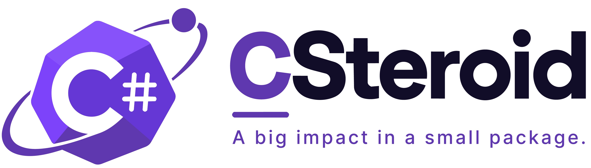

[](https://github.com/Tyme-Bleyaert/CSteroid/actions/workflows/ci.yml)
[](https://www.nuget.org/packages/CSteroid.Core)

CSteroid is a .NET component library that generates models, validation, and mappings from a single interface. It implements [Interface-First Model Generation (IFMG)](https://github.com/Tyme-Bleyaert/Interface-First-Model-Generation-Concept).

Add the `CSteroid.Generator` package to the target project, reference `CSteroid.Core`, and decorate an interface with `CanonicalModelAttribute`. The generator emits `partial` classes that you can extend in your own files. Mapping and validation live in separate packages (`CSteroid.Generator.Mapping`, `CSteroid.Generator.Validation`), as does each ORM target (`CSteroid.Generator.EFCore`, `.Dapper`, `.CosmosDB`, `.MongoDB`, `.PostgreSQL`) — reference only what you use.

## Features

- **Interface-first models** – one interface produces multiple `partial` classes (class, record, or struct).
- **Property exclusion** – exclude a property from one or all generated models.
- **XML documentation preservation** – interface doc comments flow to generated properties and mappers.
- **Nested objects & collections** – automatically map child models and supported collection shapes (`IEnumerable<T>`, `ICollection<T>`, `IList<T>`, `List<T>`, arrays, `HashSet<T>`).
- **Circular reference guard** – generation-time diagnostic (`CSG100`) when a cycle is detected.
- **Mapping options** – extension methods, static methods, implicit/explicit casts, dependency-injection mappers, and `IQueryable<T>` projection expressions.
- **ORM optimisations** – conventions and attributes for EF Core, Dapper, Cosmos DB, MongoDB, and PostgreSQL, each shipped as its own generator package. Reference `CSteroid.Orm` and apply `[OrmTarget(OrmTarget.EFCore)]` alongside `[CanonicalModel(...)]` to route the model to the matching package. A model may carry only one `OrmTarget` flag (`CSG101` otherwise).
- **Validation** – DataAnnotations forwarding, custom fluent validation, async validation, conditional rules, cross-property rules, and nested object & collection validation.
- **Configuration** – custom namespaces, folder paths, file naming (`*.model.cs`), and logical separation of validators/mappings into different namespaces.

## Example

```csharp
using CSteroid;
using System.ComponentModel.DataAnnotations;

[CanonicalModelAttribute("MyApp.User", MappingTypes = MappingTypes.ExtensionMethod)]
[CanonicalModelAttribute("MyApp.UserDto", ValidationType = ValidationType.Custom | ValidationType.Async)]
public interface IUserModelDefinition
{
    public int Id { get; set; }

    [Required]
    [MaxLength(100)]
    public string Name { get; set; }

    [EmailAddress]
    public string Email { get; set; }

    [ExcludeFromGeneration("MyApp.UserDto")]
    public string SocialSecurity { get; set; }
}
```

Generated output includes:

```csharp
// MyApp.User
public partial class User
{
    public int Id { get; set; }
    public string Name { get; set; }
    public string Email { get; set; }
    public string SocialSecurity { get; set; }
}

// MyApp.UserDto
public partial class UserDto
{
    public int Id { get; set; }
    public string Name { get; set; }
    public string Email { get; set; }
}

// Mappings
internal static class MappingExtensions
{
    internal static UserDto MapToUserDto(this User item) { ... }
    internal static User MapToUser(this UserDto item) { ... }
}

// Validator
internal partial class UserDtoValidator : IAsyncValidator<UserDto>
{
    public async Task<ValidationResult> ValidateAsync(UserDto model, CancellationToken ct = default)
    {
        ...
    }
}
```

## Getting started

**Requirements:** .NET SDK 6.0.100+ (or Visual Studio 2022+). The generated code uses
C# 9 features (target-typed `new`, `is not null`), so the consuming project needs
language version 9 or higher. The library itself targets `netstandard2.0` and runs
on .NET Framework 4.6.1+ through .NET 10+.

The typical workflow is: **define interfaces → build (generates) → override the partials you need**.

1. **Reference the packages.** Either the all-in-one package, or `CSteroid.Core` (attributes)
   plus the generators you want individually:

   ```bash
   # Option A — everything common in one package:
   dotnet add package CSteroid

   # Option B — pick and choose:
   dotnet add package CSteroid.Core
   dotnet add package CSteroid.Generator           # models
   dotnet add package CSteroid.Generator.Mapping   # MapToX() / casts / DI
   dotnet add package CSteroid.Generator.Validation # validators
   # plus one per ORM: CSteroid.Generator.EFCore, .Dapper, .CosmosDB, ...
   ```

2. **Define a model interface** decorated with one `[CanonicalModel]` per class you want:

   ```csharp
   [CanonicalModelAttribute("Order", MappingTypes = MappingTypes.ExtensionMethod)]
   [CanonicalModelAttribute("OrderDto")]
   public interface IOrderModelDefinition
   {
       public int Id { get; set; }
       public string Product { get; set; }
   }
   ```

   Every attribute instance becomes one generated class; all targets on the same
   interface can map to each other.

3. **Build.** The generators emit `Order`, `OrderDto` (partial classes with the
   interface properties), the `Order.MapToOrderDto()` extension, and any validators.
   Generated files start with `// <auto-generated />`; regenerate on every build.

4. **Extend via partials** in your own files — never edit generated code:

   ```csharp
   // Order.Behavior.cs — your file, same namespace as the generated Order
   public partial class Order
   {
       public decimal Total => Quantity * UnitPrice;
   }

   // UserDtoValidator.cs — hook into the generated validator
   internal partial class OrderDtoValidator
   {
       static partial void ConfigureValidation(ValidationConfiguration<OrderDto> config)
       {
           config.AddRules(rules => rules.For(x => x.Product).NotEmpty());
       }
   }
   ```

   Mappers have an equivalent hook (`static partial void ConfigureMapping(...)`) unless
   the model was marked `Simple = true`, which skips the override machinery for a
   branch-free, non-overridable fast path.

### Multi-project solutions (metadata-lib mode)

Keep the interfaces in a shared library that references only `CSteroid.Core` (no
generators), and let each layer project generate the models it owns:

```csharp
// inside MyApp.Order.Application.csproj — claims only its own namespace
[assembly: GeneratorConfig(
    GenerateOnlyNamespaces = new string[] { "MyApp.Order.Application.Dtos" })]
```

Each project attaches the generator packages and lists the namespaces it claims.
Mappings are emitted in the project that owns the destination type, so dependencies
always point inward (Domain never sees DTO mappings, etc.). Without the filter, every
referencing project generates every model and builds collide. See
[`examples/HexagonalDdd/`](examples/HexagonalDdd/) for a full working solution.

## Instructions for AI coding assistants

If you use an AI assistant on a codebase that consumes CSteroid, copy the block below
into its instructions file (e.g. `AGENTS.md`, `.cursor/rules`, or a Copilot
instructions file) so it uses the library correctly:

````
## CSteroid (source generators)

- This project uses CSteroid: models, mappings and validators are GENERATED at
  build time from interfaces marked with [CanonicalModel(...)].
- To add or change a model, edit the interface (or add an attribute instance for a
  new target), then build — the generator emits the classes. Never hand-write the
  generated model classes, and never edit files that start with // <auto-generated />.
- Extend generated types only through `partial` classes in separate files. Custom
  validation goes in `static partial void ConfigureValidation(...)`, custom mapping
  in `static partial void ConfigureMapping(...)` — both in your own partials.
- Generated members are deterministic (alphabetical). `MappingTypes` flags choose
  how models map: ExtensionMethod, Static, ImplicitCast, ExplicitCast,
  DependencyInjection, ProjectionExpression.
- Do not change attribute constructor signatures; they are the public API.
- Multi-project solutions use metadata-lib mode: interfaces live in a shared
  library, and each consuming project claims its namespaces via
  [assembly: GeneratorConfig(GenerateOnlyNamespaces = new string[] { "..." })].
````

## Configuration

### Enums and attributes

`MappingTypes`, `ValidationType`, `DeclarationType`, `OrmTarget`, and `FileNamingConvention`, plus the full attribute signatures, are documented in [`docs/api.md`](docs/api.md). Combine `ValidationType.Custom | ValidationType.DataAnnotations` to forward attributes and seed default rules; `Custom | Async` generates an async validator with `MustAsync` support.

### Custom and ORM-specific attributes

DataAnnotations and schema annotations (`[Required]`, `[MaxLength]`, `[Key]`,
`[Column]`, ...) are forwarded automatically. For anything outside those
namespaces — EF Core's `[Precision]`, `[Comment]`, or your own custom
attributes — opt in per target with `ForwardPropertyAttributes`. The flag is
per target so an entity can carry EF-specific attributes while a sibling DTO
target (whose project may not reference EF Core) stays clean:

```csharp
[CanonicalModelAttribute("OrderEntity", ForwardPropertyAttributes = true)]
[CanonicalModelAttribute("OrderDto")]
public interface IOrderModelDefinition
{
    [Microsoft.EntityFrameworkCore.Precision(18, 2)]
    public decimal Total { get; set; }
}
```

Forwarded attributes are emitted fully qualified, so no extra `using` is needed
in the generated file. EF-specific *configuration* (indices, conversions,
relationships) can also be expressed fluently via the `ConfigureEntity`
partial hook in the EF Core package.

### Assembly-level generator configuration

```csharp
using CSteroid;

[assembly: GeneratorConfig(
    FileNamingConvention = FileNamingConvention.ModelSuffix,
    ValidationProject = "MyApp.Application.Validation",
    MappingProject = "MyApp.Infrastructure.Mappings",
    // Multi-project only: which model namespaces THIS project generates.
    GenerateOnlyNamespaces = new string[] { "MyApp.Order.Domain.Models" })]
```

### Custom validation

```csharp
internal partial class UserDtoValidator
{
    static partial void ConfigureValidation(ValidationConfiguration<UserDto> config)
    {
        config.AddRules(rules =>
        {
            rules.For(x => x.Email)
                 .MustAsync(async (email, ct) =>
                 {
                     await Task.Delay(1, ct);
                     return !string.IsNullOrEmpty(email) && email.Contains("@");
                 }, "Email is invalid.");
        });
    }
}
```

## Support

CSteroid is free and open source. 

[](https://ko-fi.com/T2I228YJGQ)

## License & Branding

* **Code:** The source code in this repository is licensed under the [MIT License - Copyright 2026 Tyme-Bleyaert](LICENSE).
* **Trademarks & Logos:** The project name, logo, wordmarks, and associated visual assets are **not** covered by the MIT License. They remain Copyright 2026 Tyme-Bleyaert, all rights reserved.

## Credits/Shout-outs

* **Logo:** The logo was designed by [Sector Seven](https://www.fiverr.com/s7branding).